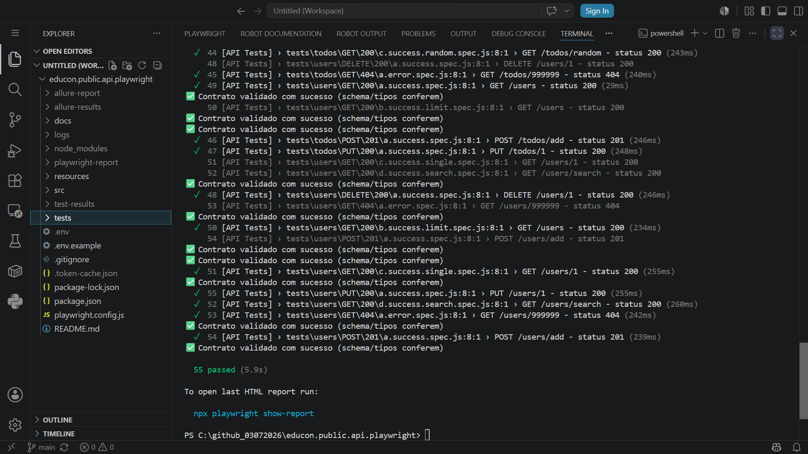
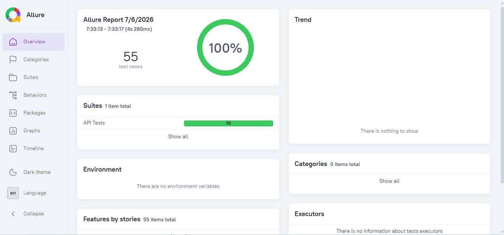
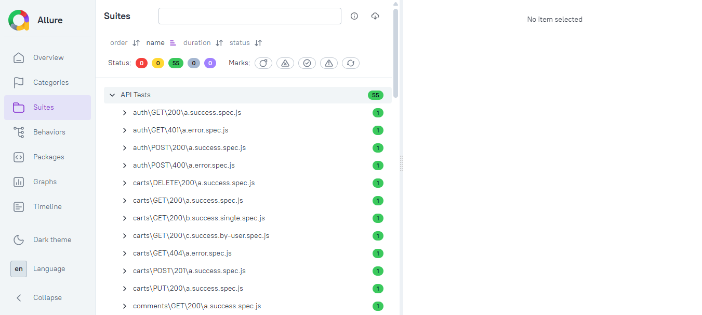
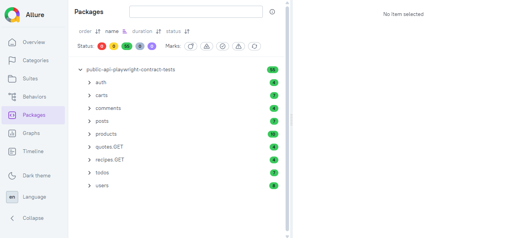
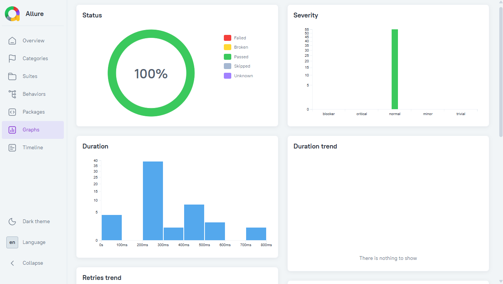

# Testes de API - Contratos com API Pública (DummyJSON)

Testes de integração e contrato de API pública (https://dummyjson.com/docs), com Playwright.


## 🚀 Como Começar

```bash
# 1. Clone o repositório
git clone https://github.com/moiseschiaretto/NOME-DO-REPO.git
cd NOME-DO-REPO

# 2. Instale as dependências
npm install
npx playwright install --with-deps chromium

# 3. Configure o ambiente
cp .env.example .env

# 4. Execute os testes (recomendado)
npm run test:refresh-token  # Atualiza o token + executa os testes

# Ou execute separadamente:
npm run refresh-token  # Só atualiza o token
npm run test           # Só executa os testes
```

Relatório HTML: `npx playwright show-report`

## Relatório Allure

```bash
npm run test:allure   # roda os testes + gera o relatório
npm run allure:open    # sobe um servidor local e abre o relatório no navegador
```

(gera os dados e o relatório final via `allure-commandline`, sem precisar instalar o Allure no sistema)

> ⚠️ **Não abra `allure-report/index.html` direto no navegador** (duplo clique / `file://`). O Allure carrega os dados via requisições JS, que o Chrome/Firefox bloqueiam por segurança quando o arquivo é aberto localmente sem servidor. Use sempre:
> ```bash
> npm run allure:open
> ```
> Isso sobe um servidor local e abre o relatório completo, com todos os dados carregando corretamente.

Comandos individuais, se preferir rodar por etapas:

```bash
npm run allure:clean      # limpa allure-results/ e allure-report/
npm run test               # gera allure-results/
npm run allure:generate   # gera o HTML a partir dos resultados
npm run allure:open        # serve e abre o relatório
```

---

## 📸 Resultados de execução

**Execução via terminal (VSCode) — 55 testes passando:**



**Relatório Allure — Visão geral (100% de sucesso):**



**Relatório Allure — Suítes (cenários organizados por endpoint/método/status):**



**Relatório Allure — Pacotes por recurso:**



**Relatório Allure — Gráficos (status, gravidade e duração):**



---

## Por que uma API pública?

Este projeto reproduz, com dados públicos, o mesmo padrão de arquitetura usado em projetos reais de automação: separação entre configuração, utilitários genéricos, fixtures de contrato e testes organizados por recurso/método/status.

## Stack

- **Playwright** (`@playwright/test`) para execução das requisições
- **Joi** + **to-json-schema** para geração e validação de contrato (schema dinâmico a partir de uma amostra)
- **Allure** para relatórios
- **GitHub Actions** para CI/CD (roda a cada push e diariamente, para detectar quebras de contrato na API pública)

## Estrutura

```
src/
  config/
    environment.js     # variáveis de ambiente (base URL, credenciais, token em cache)
    endpoints.js        # constantes de endpoints
  utils/
    requests.js          # makeRequest() — função única para todos os métodos HTTP
    validators.js        # validação de contrato (schema/tipos) e validação exata
    files.js              # salva logs de response em JSON e carrega fixtures
    auth-token.js         # autentica e cacheia o accessToken localmente
tests/
  {recurso}/{METODO}/{status}/*.spec.js
resources/fixtures/
  public-api/{recurso}/{METODO}/{status}/*.json   # "contratos" esperados (schema, não valor exato)
docs/
  screenshots/          # capturas de tela da execução e dos relatórios
logs/                    # responses reais salvas a cada execução (não versionado)
```

## Por que validação de contrato por SCHEMA (e não por valor exato)?

Como a API é pública e os dados mudam (preços, quantidades, IDs), validar valor por valor quebraria os testes sem motivo real. Por isso a validação (`validateResponseWithJsonSchema`) verifica **estrutura e tipos** — o "contrato" — permitindo que os valores variem livremente. Isso é o padrão usado em testes de contrato no mercado (o objetivo é garantir que a API não mudou o formato da resposta, não que os dados sejam idênticos a ontem).

## Cobertura de cenários

**55 cenários** cobrindo 9 recursos (`auth`, `products`, `users`, `carts`, `todos`, `posts`, `quotes`, `recipes`, `comments`), com múltiplos métodos (GET, POST, PUT, DELETE) e múltiplos status por método (200, 201, 400, 401, 404).

## Credenciais

As credenciais em `.env.example` são o **usuário de demonstração publicado oficialmente pela própria DummyJSON** na documentação (https://dummyjson.com/docs/auth) — não são segredo de ninguém, servem só para gerar um token de teste válido.
